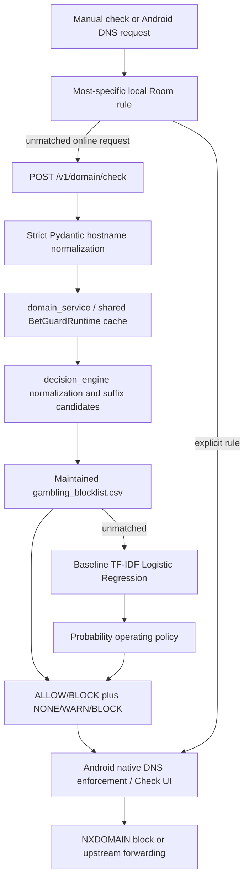

# BetGuard architecture inspection before changes

Inspection date: 11 October 2026 (Asia/Manila). This report was written before
changing any existing application file or removing caches. Evidence is in
`inspection/local_inventory.json` and `inspection/cleanup_inventory.csv`.

## Repository and inspection scope

The workspace contains two Git repositories. The outer repository is on
`master`, has no commits, and stages the nested `betguard` gitlink. The actual
application repository is `betguard/`, branch `main`, HEAD
`983b244` ("Blocking thru the phone network added"). Its initial status has
modified frontend/backend/configuration files and untracked router source,
tests, datasets and experiments. These are existing user work, not cleanup.
No checkout, reset, commit, index changes or submodule repair is appropriate.

The recursive inventory reads 483 accessible project files, parses 97 Python
modules and counts 93 CSV artifacts. Third-party installations (`node_modules`,
both `.venv` directories), Git internals, native build outputs, local state,
device captures and egg metadata are retained boundaries. Private `.env` and
keys are listed without reading their contents. One dataset directory,
`ml/data/expanded/pagcor_ph/audit_v1/verification_v2`, is inaccessible. Existing
`backend/verification/pytest-temp/run` is also inaccessible and was discovered
by Git/rg. Neither directory may be assumed empty or expendable. No applicable
AGENTS.md was found in accessible project/ancestor paths.

## Actual structure and startup

```text
betguard/
  frontend/                 React Native app, native projects and tests
    index.js, App.tsx       app registration and bottom-tab navigation
    src/api/                HTTP client, domain/catalog/app/router contracts
    src/state/              React contexts, native bridge contract, themes
    src/screens/            Home, Check, Sites, History, Applications, settings
    android/.../filter/     Room rules/history, VPN and LAN proxy services
    ios/                    iOS shell; Android enforcement is not an iOS feature
    scripts/                APK build/install and controlled device checks
  backend/
    app/main.py             FastAPI lifespan and router registration
    app/api/                domain, catalog, metadata, health and router routes
    app/core/               dotenv, PostgreSQL validation and engine
    app/services/           detection lifecycle, reviewed catalog, model workers
    app/schemas/            hostname validation and API response contracts
    app/models.py           reviewed domain catalog ORM
    app/ml/                 optional skops serving, feature/integrity helpers
    app/router/             existing uncommitted DNS/router implementation
    migrations/             Alembic revision 0001_catalog
    ml_tools/               separate offline audited skops development pipeline
    tests/, docs/, models/  tests, research/operations, optional model releases
  ml/
    pyproject.toml          editable betguard-runtime package mapped to src/
    src/                    live runtime + separate offline experiment scripts
    models/                 baseline/hybrid/SVM/RF binaries and selections
    data/raw/               original SSL/DNS dataset
    data/processed/         verified/balanced data, splits and external holdout
    data/runtime/           maintained gambling list and standalone user lists
    data/expanded/          source manifests, candidates, PAGCOR review evidence
    reports/                historical experiment predictions and metrics
  docs/, verification/, build/
```

Mobile entry is `frontend/index.js` -> `App.tsx`; npm commands run in
`frontend/`. `npm start`, `npm run android` (developmentDebug), production
release scripts and Gradle are actual deployment mechanisms. React 19.2.3,
React Native 0.87.1, TypeScript, React Navigation and Android Kotlin implement
the mobile app. Jest, ESLint and TypeScript checks are provided. iOS uses
Swift/CocoaPods. Native changes require rebuilding the APK, not just Metro.

Backend startup is, from `backend/`, `.venv/Scripts/python -m uvicorn
app.main:app --host 127.0.0.1 --port 8000 --reload --no-access-log`.
FastAPI/SQLAlchemy/Alembic/psycopg/python-dotenv/dnslib are runtime dependencies.
Lifespan loads an engine (or records unavailable configuration), optional
catalog and app metadata workers, and **one** `BetGuardRuntime`. Optional
router initialization is controlled by existing `BETGUARD_ROUTER_*` settings.
Startup does not train, download blocklists or run candidate verification.
`ml/src/api_service.py` is an explicit retired-server message, not a second
active API. `predict.py` is a working-directory-dependent offline classifier
CLI; it is not the enforcement engine. Training and audit scripts are explicit
commands; the dependency/import inventory records their actual imports.

`ml/pyproject.toml` maps the package name `betguard_runtime` to `ml/src`.
`BETGUARD_ML_ROOT` relocates resources; defaults use the source directory.
This editable install depends on adjacent data/model files, which are not
bundled by the current wheel configuration. A clean clone also lacks ignored
joblib artifacts. Preserve and checksum deployed resources separately.

## Detection, rules and blocking flow



`app/api/domain.py` -> `services/domain_service.py` -> installed
`betguard_runtime/runtime_service.py` -> `decision_engine.py` is the active
inference path. `runtime_paths.py` resolves resources independently of CWD.
The backend first rejects credentials, IP addresses, invalid labels, schemes,
ports and whitespace through `schemas/catalog.py::normalize_hostname`.
The older runtime strips `www.` and a final dot and builds suffix candidates
down to the offline PSL registrable domain. Its standalone normalization is
more permissive than the API and can raise for some malformed URLs; changing
that older behavior requires dedicated compatibility work.

Standalone engine precedence is allowlist -> user blocklist -> maintained
list -> ML. The server deliberately uses `use_user_lists=False`: device
exceptions live in Room and must never become shared server exceptions.
Android `DomainPolicy.match` and existing router `SharedPolicy` instead use
the **most-specific matching manual rule**. Thus a child block can win over a
parent allow; a child allow can win over a parent block. This intentional
policy is not changed to a blanket allow-first policy.

The live manifest `ml/models/deployment_candidate.json` selects `baseline`,
loading `baseline_domain_classifier.joblib` once. Runtime score >= 0.70 blocks;
score >= **0.512117** warns while allowing; lower scores allow. These constants
are enforcement thresholds. The manifest's full-precision selected threshold
0.5121174012449518 is an evaluation operating point and is not directly read
by the enforcement branches. Blocklist decisions have no ML score. Runtime
cache is bounded, locked, normalized and cleared on rule/list reloads.

`/v1/domain/check` and `/v1/domain/check-batch` return stable decision schemas.
Backend `ml_score` validation, JS `validDecision` and Kotlin `DetectionClient`
all restrict scores to [0,1]. Raw SVM margins cannot be inserted into this
contract or displayed as percentages. API inference failures return 503;
online native DNS detection failures return SERVFAIL/degraded, not a fabricated
decision. Manual mode can operate without FastAPI. WARN forwards DNS and
records an intervention; it is not a DNS block. The Android VPN intercepts its
configured ordinary DNS route; encrypted DNS, established connections and
other unsupported paths can bypass that feasibility mechanism. Device/network
acceptance cannot be inferred from unit tests.

## Separate catalog, app review and databases

`/v1/check` queries the SQLAlchemy `DomainCatalog` in PostgreSQL schema
`betguard_private`. Definitive reviewed catalog entries take precedence over
the **separate optional** skops hostname worker in `model_service.py`; reviewed
unknown is deliberately retained. This is distinct from `/v1/domain/check`
and does not load the finalized baseline joblib through `ModelService`.
`/v1/apps/check` is public app metadata review using a separately configured
optional artifact worker; it does not infer installed app behavior from DNS.

Alembic `0001_catalog` defines hostname primary key, classification, provenance,
review status and timestamp with consistency constraints and role grants.
Runtime PostgreSQL configuration requires psycopg, TLS and direct/session
connections; migration credentials are separate. Engine connection/statement
timeouts and pooling are bounded. No database migration/schema changes are
needed for this audit. Android Room persists rules/history on the device.
The router module separately persists replicated rules, sessions and monitoring
in local SQLite. No database or user-upload deletion is justified.

Health routes distinguish process (`/health/live`), database/migration
(`/health/ready`), detection (`/health/detection`) and app-model readiness.
Secrets are read by existing dotenv configuration and should never appear in
reports, logs or shell output. Frontend public API configuration and version
files are public build inputs, not database credentials.

## ML architecture and initial issues

Historical joblib domain experiments are in `ml/src`; the backend's
`ml_tools` pipeline is a separate stricter reviewed-data/skops protocol and is
not a duplicate disposable implementation. Baseline, hybrid, ordinary SVM,
Random Forest and optimization/frozen evaluation all have evidence to retain.
Label and PAGCOR verification/expansion scripts support different review
stages; no source files can be removed simply by filename/version.

The optimized frozen experiment combines char TF-IDF (2,6), min_df=1 with
25 lexical values, LinearSVC(C=0.5, balanced, random_state=42, max_iter=10000)
and margin threshold -0.05278699316952151. `evaluate_frozen_svm.py` fits on
507 training records and reproduces validation before evaluating historical
test. It saves metrics/predictions **but no model**. The existing
`svm_domain_classifier.joblib` belongs to a different char-(3,5), min_df=2,
non-lexical SVM at -0.07233326051015576. JSON selection is not a trained model.

Issues requiring evidence or follow-up:

- Missing optimized artifact; no margin-compatible active API/blocking policy.
- The “frozen features” file also contains the optimization executable; calling
  its `main` would tune. Reuse its feature functions only; preserve original.
- Historical baseline numbers in the request conflict with local baseline
  test evidence; saved predictions must adjudicate comparison claims.
- Blocklists/candidate registry entries are source-supported references, not
  proof of independently human-verified direct wagering on every domain.
- Frozen experiment dependency/input digests were not recorded at the time;
  current matching versions alone cannot establish historical provenance.
- Existing artifact ignores, adjacent resource paths and separate dependency
  manifests mean deployment must preserve binaries and pinned environments.
- Two router `.backup` files and a baseline console log may preserve user work;
  retain pending review, regardless of reference searches.
- Permission-denied verification data prevent a claim of complete dataset review.

## Authorized next steps

Preserve an exact checkpoint before any tracked-file edit. Only inventory-listed
Python/pytest cache files are eligible for automatic removal after checks.
Retain all datasets, binaries, review files, private state, builds and backups.
Recalculate metrics and leakage checks without rewriting historical artifacts.
Prepare a versioned optimized artifact and an **offline shadow-only** adapter
only if the frozen validation result reproduces; never connect it to active
blocking while readiness gates remain unmet. Keep current folder boundaries,
production configuration, APIs, UI, database schema and router behavior.
