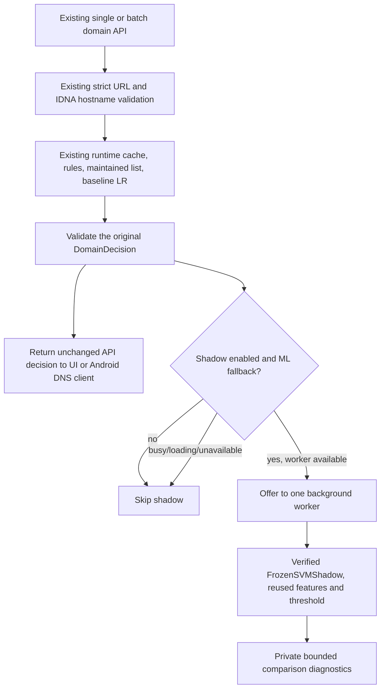

# Optimized SVM backend shadow integration

Completed 11 October 2026 (Asia/Manila).

**Implemented: optional backend shadow classification using the existing verified
artifact. Default: disabled. Logistic Regression and existing rules remain
authoritative for every production decision. No SVM-based blocking is enabled.**

The earlier [architecture audit](AUDIT_REPORT.md) is a historical report of the
pre-integration state. Its dataset/metric evidence and existing model artifacts
were preserved; this report documents the subsequent authorized integration.

## Files changed

| File under betguard/ | Change and purpose |
| --- | --- |
| backend/app/core/config.py | Centralized shadow enable flag, versioned artifact location and pinned external manifest digest; existing DB configuration preserved |
| backend/app/services/svm_shadow_service.py | New asynchronous load/comparison service, one-worker admission control, failure circuit and bounded private diagnostics |
| backend/app/services/domain_service.py | Optional shadow argument and request dependency; observe only after successful production evaluation/response validation; isolate observer errors |
| backend/app/api/domain.py | Inject the optional lifespan-owned shadow service into existing single/batch routes; no new endpoints or response fields |
| backend/app/main.py | Construct one service per FastAPI process, own its lifecycle, and close it at shutdown; existing router startup/shutdown preserved |
| backend/.env.example | Document BETGUARD_SVM_SHADOW_ENABLED=false without modifying the private .env |
| backend/README.md | Link this report and describe optional operation/rollback |
| backend/tests/test_svm_shadow_integration.py | 41 integration/configuration/failure/privacy/concurrency regressions using the already exported artifact |
| docs/audit/2026-10-11/SVM_SHADOW_INTEGRATION.md | This integration report with commands, architecture, evidence and remaining production gates |

Local verification artifacts are in Git-ignored
`verification/svm-backend-shadow-2026-10-11/`: `benchmark.py` (local fixture
timing harness), `latency.json`, `preservation.json`, `integration-pytest.xml`,
`backend-regression.xml`, `frontend-regression.json` and `test-summary.json`.
The `checkpoint/`
directory contains exact pre-edit copies of the six modified existing files,
the previous tracked-work binary diff and protected input digests. Temporary
pytest fixtures/bytecode are generated verification outputs, not new runtime
assets. No Git reset, staging, dataset edits or deletion occurred.

No edits were made to `ml/src/runtime_service.py`, `decision_engine.py`, either
frozen SVM module, baseline deployment selection/binary, the SVM manifest/binary,
frontend/native source, router source, database schema or old evaluation reports.
Preservation checks found **189 existing ML source/data/model/report files
unchanged**, all eight explicitly protected inputs unchanged, and the existing
tracked user diff unchanged outside the six intended integration files.

## Actual integration architecture



FastAPI lifespan owns `app.state.svm_shadow`. The existing `/v1/domain/check`
and `/v1/domain/check-batch` routes inject it into `domain_service.evaluate`.
That service finishes and validates the baseline result first. Only then does
it offer an independent comparison; observer exceptions are outside the
production error handler and cannot turn a valid baseline response into 503.
Production inference errors still follow the original 503 failure policy.

The optional service calls the unchanged
`betguard_runtime.optimized_svm_shadow.FrozenSVMShadow.load`. It passes the
reviewed external manifest anchor
`76d4bc7779b386c7d2c4be36ff59ee14f5093c533617ce42b6e046ae331574a1`.
The original loader checks payload integrity, environment and feature/adapter
source hashes, 14,076 feature dimensions, classes [0,1], parameters and purpose.
It loads the already fitted TF-IDF vectorizer and classifier. No fit, export,
optimization, source download or threshold search runs during integration.

Normalized hostnames come from the existing validation/runtime decision.
The frozen implementation transforms char TF-IDF then appends its 25 lexical
features in the original order. Margin >= -0.05278699316952151 is classification
label 1; lower margins are label 0. Margins remain signed internal values,
never probabilities or public `ml_score` fields.

Comparison eligibility is explicit: successful **ML fallback** results only.
`ml_low_risk` maps to baseline class `non_gambling`; `ml_warning` and
`ml_high_risk` map to `gambling` at the existing **warning classification
point** (0.512117). This does not treat WARN as a block: WARN remains ALLOW.
The 0.70 automatic-block threshold is unchanged. This comparison is also
distinct from the historical F1 threshold or selected manifest evaluation point.

Explicit user rules and maintained-list outcomes are not baseline ML
predictions, so they are skipped for comparison. Their precedence remains
exactly as before. In-process router `SharedPolicy` still calls the shared
domain service with its default `shadow=None`; no router code/configuration was
changed. Android online detection uses the existing HTTP routes and therefore
can produce shadow samples; manual/offline rules do not require the model.
Other internal callers can explicitly reuse `evaluate(..., shadow=service)`.

## Resource, failure and privacy behavior

- **Disabled:** no SVM loader import, artifact deserialization or worker creation;
  the optional observer returns without inference.
- **Enabled startup:** loading runs in one background thread. Requests during
  loading continue normally and increment a skip counter.
- **Ready:** at most one inference is outstanding. Admission never waits for
  inference; a busy worker drops additional offers instead of accumulating a
  queue. Batch comparisons are sampled, not guaranteed exhaustive.
- **Failure:** bad configuration, missing/corrupt files, loader errors,
  submission errors and inference errors stop shadow work until restart.
  Production still returns the original decision; no fallback access decision
  is manufactured.
- **Deadlines:** 30 seconds for loading and 1.5 seconds per inference. Deadline
  checks on the next offer, diagnostic snapshot or completion open the circuit;
  late results are discarded. Python threads cannot be forcibly killed: one
  timed-out task can continue running and keeps its sole capacity until it ends.
  There is no automatic retry or replacement worker. Shutdown cancels queued
  work without waiting on the active task; a permanently hung thread could
  still delay interpreter exit and would require terminating/restarting the
  server process. This is a documented shadow-service operational limit.
- **Diagnostics:** a thread-safe deque retains at most 128 records and aggregate
  counters. Records contain baseline class, SVM class, internal signed margin,
  agreement, success/error type and elapsed milliseconds. No hostname, URL,
  client IP, user ID, request ID or timestamp is retained in shadow diagnostics.
  No new HTTP endpoint, database table, user history upload or persistent
  browsing-log file was added.

Use `app.state.svm_shadow.snapshot()` in a debugger **attached to the running
server process** to inspect private counters/records. A separate Python console
does not share that process's state. Records are cleared at shutdown. Logs
announce readiness/version and sanitized failure types; they do not log
per-domain SVM predictions. Existing baseline hostname logging is unchanged.
Busy/loading skips are counted, so agreement counters describe completed
samples, not all traffic. There is no new concurrency guarantee for DNS devices
or an independent real-world accuracy measurement from these samples.

## How to run on Windows PowerShell

Use the existing installed backend environment and ML package. No dependencies
were added. Keep the trusted artifact and both frozen source modules intact;
the loader deliberately rejects code/environment drift. These commands change
only the launched process environment; they do not overwrite `.env`, user data
or router configuration. Stop the old server before restarting on port 8000.

Baseline-only operation:

```powershell
Set-Location 'C:\Users\daniel jay bernadas\Desktop\BetGuard\betguard\backend'
$env:BETGUARD_SVM_SHADOW_ENABLED = 'false'
.\.venv\Scripts\python.exe -m uvicorn app.main:app --host 127.0.0.1 --port 8000 --reload --no-access-log
```

Enable optional shadow comparison:

```powershell
Set-Location 'C:\Users\daniel jay bernadas\Desktop\BetGuard\betguard\backend'
$env:BETGUARD_SVM_SHADOW_ENABLED = 'true'
.\.venv\Scripts\python.exe -m uvicorn app.main:app --host 127.0.0.1 --port 8000 --reload --no-access-log
```

Unset/false/0 disables shadow; true/1 enables it (case/whitespace normalized).
Other values leave shadow unavailable with a sanitized warning, while the
baseline continues. Restart is required; this is not a live activation switch.

Default artifact directory is
`C:\Users\daniel jay bernadas\Desktop\BetGuard\betguard\ml\models\optimized_svm_shadow_2026-10-11`.
For the existing relocated-resource deployment convention, set
`BETGUARD_ML_ROOT` before launch to the trusted ML root containing `models/`
and `data/runtime/`; shadow uses that same root and the pinned version/hash.
Do not change the root just to enable shadow: it also relocates baseline inputs.
The existing `*.joblib` ignore still applies; a Git clone alone may not contain
the binary. No arbitrary artifact upload or external-hash override is provided.

In another PowerShell window, exercise a non-transactional fixture request:

```powershell
Invoke-RestMethod -Method Get -Uri 'http://127.0.0.1:8000/health/detection'
Invoke-RestMethod -Method Post -Uri 'http://127.0.0.1:8000/v1/domain/check' -ContentType 'application/json' -Body '{"domain":"bpi.com.ph"}'
```

Detection health still identifies `baseline`. The fixture remains ALLOW/NONE,
even though the shadow SVM predicts label 1. Shadow startup can still be loading
on the earliest requests; wait for the `SVM shadow ready` log before expecting
comparison records. Public response fields contain no SVM status/margins.

To reproduce the local timing/diagnostic fixture harness without contacting a
database, router, third-party site or physical device:

```powershell
Set-Location 'C:\Users\daniel jay bernadas\Desktop\BetGuard\betguard\backend'
.\.venv\Scripts\python.exe ..\verification\svm-backend-shadow-2026-10-11\benchmark.py
```

It uses TestClient, the original loaded models and temporary process flags;
its output is local `latency.json`. These fixture diagnostics are not a view of
a separately running uvicorn server or its users' requests.

## Executed testing and observations

From `betguard/backend`:

```powershell
.\.venv\Scripts\python.exe -m pytest tests/test_svm_shadow_integration.py -q -p no:cacheprovider --basetemp ..\verification\svm-backend-shadow-2026-10-11\integration-pytest --junitxml=..\verification\svm-backend-shadow-2026-10-11\integration-pytest.xml
.\.venv\Scripts\python.exe -m pytest -q -p no:cacheprovider --ignore=tests/test_optimized_svm_shadow.py --basetemp ..\verification\svm-backend-shadow-2026-10-11\backend-regression --junitxml=..\verification\svm-backend-shadow-2026-10-11\backend-regression.xml
```

From `betguard/frontend`:

```powershell
npm.cmd test -- --runInBand --testTimeout=30000 --json --outputFile=../verification/svm-backend-shadow-2026-10-11/frontend-regression.json
```

| Executed check | Actual result |
| --- | --- |
| Initial focused integration run | 36 passed, 36.40 seconds (before five additional timeout/shutdown/normalization cases) |
| Final backend regression run | **185 passed, 1 skipped**, 136.45 seconds; includes all **41** final integration cases and existing router regressions |
| Frontend Jest regression | **149 passed, 14 suites**, 58.342 seconds |
| Existing artifact preservation | PASS: protected digests and all 189 inventoried ML files unchanged |
| Existing user-work preservation | PASS: previous tracked diff unchanged outside the six intended integration files |
| Local fixture comparison benchmark | PASS: 30 disabled + 30 enabled HTTP responses identical; enabled model loaded once; 30 comparisons completed, 10 agreed and 20 disagreed |

The first focused command above was executed on the initial 36-case test file;
the final backend command executed the expanded 41-case file. The previous
`test_optimized_svm_shadow.py` audit/export suite is intentionally excluded
because its fixture trains/exports another optimized model. It was already
verified in the architecture audit and no frozen artifact code changed.
This integration loads the existing release instead of recreating it. Other
existing software tests can train small synthetic fixtures; they do not
retrain or replace the deployed/optimized artifact.

New regressions cover disabled/enabled startup, real artifact load-once/parity,
agreement/disagreement, strict/IDNA normalization, public response and OpenAPI
equality between modes, invalid-request isolation, missing/corrupt artifact
failure, inference/observer failure, unchanged allowlist/blocklist precedence,
SVM-positive baseline-ALLOW behavior, bounded concurrency, load/inference
timeouts, submit failure, late result suppression, shutdown and repeated
hostname-free diagnostics. In a controlled blocked-worker test, 32 concurrent
offers were rejected immediately while the sole inference retained capacity.

Local timing with the baseline cache disabled (30 requests per mode):

| Timing | Shadow disabled | Shadow enabled |
| --- | ---: | ---: |
| Median HTTP fixture request | 6.15 ms | 8.00 ms |
| 95th percentile HTTP fixture request | 8.95 ms | 10.70 ms |
| Maximum HTTP fixture request | 64.82 ms | 12.75 ms |
| Median completed shadow inference | — | 2.12 ms |
| 95th percentile completed shadow inference | — | 3.59 ms |
| Maximum completed shadow inference | — | 3.87 ms |

This short sequential in-process sample is a software timing observation, not
a load-test guarantee or statistically isolated estimate of overhead. Shared
CPU scheduling, warm-up and TestClient overhead affect timing. High-rate
traffic can drop shadow offers intentionally; no enforcement request waits for
SVM completion. Real-world latency/accuracy/load gates remain unverified.

The PostgreSQL test was skipped because a confirmed dedicated test database
was not configured. No hosted database connection or migration was performed.
Existing Starlette/httpx and anyio deprecation warnings remain. Physical-device,
APK, live DNS/router/network enforcement and wagering tests were **not** run;
passing mocked/fixture tests does not establish network-wide blocking coverage.

## Production readiness and remaining activation requirements

Optional backend shadow integration is implemented and verified for the local
software environment. SVM readiness remains **CONDITIONALLY READY for
shadow/staging**. Automatic blocking still has unmet gates; no activation flag
exists.

Completed: verified release loading, shared frozen features/orientation,
normalized input, internal signed margins, load-once lifecycle, independent
nonblocking comparisons, privacy-preserving bounded diagnostics, graceful
shadow failure and regression-proven unchanged baseline responses.

Before any future production promotion, still required:

1. Fresh independently reviewed PH/real-world data, family/brand-disjoint
   validation and resolution of inaccessible/unverified review evidence.
2. Explicit acceptance criteria for false positives/negatives, including ordinary
   financial/educational sites; existing historical and exploratory warnings
   remain as documented in the earlier audit.
3. Separate validated classification, warning and hard-block margin thresholds;
   the saved validation-accuracy threshold alone does not authorize blocking.
4. A compatible inference/API/mobile adapter or independently validated
   calibration. No raw margin may masquerade as [0,1] probability/`ml_score`.
5. Explicit reviewed classifier version selection, protected rule/list
   precedence, missing-model failure policy and immediate LR rollback.
6. Controlled Android/router staging and realistic latency/load/operational
   tests, including DNS failures and user exceptions. If hard termination of
   failed inference is required, evaluate process isolation before promotion.

The existing frozen loader is reusable by a future inference adapter and the
optional comparison argument already lives in the shared detection service.
That future work need not reimplement feature extraction or the detection
engine. Promoting the SVM must be a separate reviewed deployment change; this
feature flag cannot select it as an authoritative classifier.

## Rollback to baseline-only operation

Stop the backend with Ctrl+C, then restart from the same environment:

```powershell
Set-Location 'C:\Users\daniel jay bernadas\Desktop\BetGuard\betguard\backend'
$env:BETGUARD_SVM_SHADOW_ENABLED = 'false'
.\.venv\Scripts\python.exe -m uvicorn app.main:app --host 127.0.0.1 --port 8000 --reload --no-access-log
```

If shadow was configured in a separate service/container environment, set its
flag to false there and restart that process too. Setting false explicitly
overrides a private dotenv value for this launch. Leave the existing
`BETGUARD_ML_ROOT`, model selection, lists, Room data, router settings and
database untouched. `/health/detection` must still report `baseline` and the
original fixture decisions must still succeed. Restart clears in-memory shadow
records. No model restoration, dependency reinstall, database migration, Git
reset or router rollback is necessary because production never left LR.
