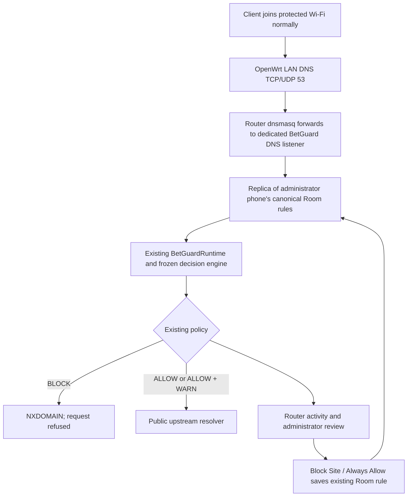

# Router Protection: OpenWrt prototype

Router Protection is an additive mode for a router you own or administer. Device Protection remains the Android DNS/VPN filter. Hotspot Protection remains the working manual HTTP/HTTPS proxy. Router Protection uses conventional DNS, without installing BetGuard or setting proxies on client devices.

**The current ISP/home router has not been confirmed as OpenWrt. No physical router was configured during development. OpenWrt hardware acceptance remains pending.** Selecting Router Protection does not change an arbitrary router or grant compatibility to an ISP model.

## Architecture



The filter runs in the existing FastAPI lifespan on a dedicated LAN server, not in the Android APK. It uses the already loaded runtime; no second model, training, dataset or threshold changes are introduced. A most-specific local rule matches exactly as Android Room's current domain policy does. Unmatched hostnames go through the existing runtime. WARN remains ALLOW + WARN; it never silently becomes BLOCK.

`RouterStore` is a private restoration journal, bounded activity store and synchronized replica of the phone's existing rules. It is not another editable blocklist. All UI rule edits still use `Native.saveRule`; the Android rule snapshot is synchronized to the server. Rule changes made while the administrator app cannot reach the server have not propagated; the app shows synchronization as unconfirmed. The persisted last acknowledged policy continues serving after the phone disconnects.

The router attaches full client IPs with EDNS Client Subnet solely for local attribution. The filter trusts those values only from an operator-configured router peer and within its verified LAN subnets. Private EDNS options are stripped before public upstream resolution. DNS history stores hostname, client IP, decision source and time; HTTP content and TLS are never inspected. Clients appear after a request reaches the filter, with a two-minute activity window; Wi-Fi association alone is not counted. Router health queries appear in request totals but are excluded from the requesting-client list.

## Prerequisites

- A separate **authorized OpenWrt test router** with one active `lan` DHCP subnet, one dnsmasq instance on port 53, and firewall4/nftables. Existing conflicting LAN DNS redirects require administrator review and are refused.
- Documented HTTPS `/ubus` access through uhttpd/rpcd, with permissions for `system.board`, `network.interface.lan`, `network.device.status`, UCI read/write/apply/confirm/rollback, and the listed diagnostic/reload executables. `uhttpd-mod-ubus` and `rpcd-mod-file` may need installation by the router administrator. BetGuard does not automatically install packages or enable remote administration.
- A trusted router HTTPS certificate valid for its LAN IPv4 address. Configure `BETGUARD_ROUTER_CA_FILE` for a private CA if needed; TLS verification is never disabled.
- A stable server LAN IPv4 address reachable by the router on **UDP and TCP 5353**. Use a DHCP reservation/static server setup managed by the administrator. The adapter checks that the server is on the discovered router LAN; it never invents a router address.
- An existing configured API path from the administrator Android phone: USB forwarding in development, or your own trusted HTTPS API deployment for a standalone APK. The DNS listener and API are different endpoints.
- A private service token of at least 32 characters configured on the backend and entered in the app. Router passwords and RPC sessions stay in memory; they are not committed, logged, saved in AsyncStorage or stored in the restoration journal.

Protect the server's journal directory with your operating system's user permissions. Keep the server awake and reachable throughout the demonstration. Use one backend worker. Do not reload/restart the backend or make concurrent router configuration edits during apply/restoration. rpcd's initial unconfirmed apply has a 60-second automatic rollback window; the durable journal also supports later recovery.

## Exact development terminals

Prepare the following private backend `.env` values using the **actual compatible test router/server addresses**. The examples below are field placeholders, not this project's current router IP. No router credentials belong in this file.

```dotenv
BETGUARD_ROUTER_ENABLED=1
BETGUARD_ROUTER_DNS_BIND=<actual stable server LAN IPv4>
BETGUARD_ROUTER_DNS_PORT=5353
BETGUARD_ROUTER_PEERS=<actual authorized OpenWrt LAN IPv4>
BETGUARD_ROUTER_UPSTREAM=1.1.1.1
BETGUARD_ROUTER_ADMIN_TOKEN=<private random token at least 32 characters>
# BETGUARD_ROUTER_CA_FILE=C:/private/router-ca.pem
```

Terminal 1 — install the new parser once, then run the existing backend **without reload while a router is protected**:

```powershell
Set-Location 'C:\Users\daniel jay bernadas\Desktop\BetGuard\betguard\backend'
.\.venv\Scripts\python.exe -m pip install dnslib==0.9.26
.\.venv\Scripts\python.exe -m uvicorn app.main:app --host 127.0.0.1 --port 8000 --workers 1
```

The optional listener binds the specified LAN address separately from the loopback API. If its configuration or binding fails, existing API modes remain available and Router Protection reports unavailable. Leave `BETGUARD_ROUTER_ENABLED` unset/0 when no compatible router is available.

Terminal 2 — Metro:

```powershell
Set-Location 'C:\Users\daniel jay bernadas\Desktop\BetGuard\betguard\frontend'
npm.cmd start
```

Terminal 3 — Android USB forwarding and existing installed debug app:

```powershell
$adbPath = "$env:LOCALAPPDATA\Android\Sdk\platform-tools\adb.exe"
& $adbPath devices
& $adbPath reverse tcp:8000 tcp:8000
& $adbPath reverse tcp:8081 tcp:8081
& $adbPath shell am start -n com.betguard.dev/com.betguard.MainActivity
```

If the server firewall blocks the dedicated listener, its administrator must permit only the router peer. On Windows, these are **optional administrator PowerShell commands**, run only after supplying the real router IP:

```powershell
$routerPeer = Read-Host 'Actual authorized OpenWrt LAN IPv4'
New-NetFirewallRule -DisplayName 'BetGuard OpenWrt DNS UDP' -Direction Inbound -Action Allow -Protocol UDP -LocalPort 5353 -RemoteAddress $routerPeer -Profile Private
New-NetFirewallRule -DisplayName 'BetGuard OpenWrt DNS TCP' -Direction Inbound -Action Allow -Protocol TCP -LocalPort 5353 -RemoteAddress $routerPeer -Profile Private
```

BetGuard does not execute those host-firewall commands. No firewall/router changes were made on the current ISP network.

## Configuration preview and exact router changes

The administrator enters the actual HTTPS router address, username and password in **Home → Open Network Protection → Router Protection**. They confirm network ownership/administration, connect securely, then separately approve the concrete preview before Apply is enabled.

The OpenWrt adapter changes only:

| Setting | Applied value |
| --- | --- |
| Selected dnsmasq `server` | List containing `<filter LAN IPv4>#5353` |
| `noresolv` | `1`, to prevent an ISP resolver fallback |
| `cachesize` | `0`, so router cache hits do not conceal clients/policy changes |
| `addsubnet` | `32,128`, for local full-IP attribution |
| `stripsubnet` | `1`, to replace client-supplied attribution |
| LAN `dhcp_option` DNS entries | Router's actual LAN IPv4; all other DHCP options retained |
| New `bg_dns_<random>` firewall redirect | LAN TCP/UDP destination port 53 → local DNS port 53, family `any` |

The redirect keeps dnsmasq as the router's DNS endpoint and redirects conventional hardcoded external DNS requests to it. DHCP lease handling, local names and internet routing remain on OpenWrt. The adapter uses documented UCI JSON-RPC calls, not arbitrary credentialed shell input; file execution is confined to fixed diagnostics, service reloads and test queries.

The service checks the applied UCI values, the live nftables redirect, and freshly observed Wikipedia ALLOW and Stake BLOCK queries from the router before confirming rpcd's apply and showing Network Active. This demonstrates the router-to-filter path. Fresh, unconfigured client tests are still required to validate physical interception, IPv6 behavior and full page loads on a particular router.

## Stop and recovery

Hold **Stop Router Protection**. The adapter checks that each touched option still equals its saved original or BetGuard value, restores the original presence/value/list, deletes only its own unchanged firewall section, reloads dnsmasq/firewall, checks restored values and verifies the live BetGuard rule is gone. An already rolled-back configuration is handled idempotently. Changes to unrelated settings are retained.

If an administrator edited a touched setting or rule, restoration refuses to overwrite that conflict. If the router goes offline or restoration cannot be verified, the UI remains recovery-required; it never reports a clean stop. Keep the DNS server available, reconnect with credentials to the original router, and retry restoration. After an interrupted initial apply, allow the 60-second rpcd rollback window to finish before verifying recovery.

A backend restart preserves the journal and activity and exposes **Router recovery required**. Re-enter the service token and securely authenticate to the original router, then Verify or Hold Stop. The adapter compares the saved LAN device MAC identity as well as the original HTTPS address; a different router at that address cannot receive the saved restoration. The password is requested again because it was not persisted. App navigation or closing the phone app does not undo a protected router's settings. Router stop does not stop Device or Hotspot Protection.

## Capstone demonstration and acceptance checklist

1. Use an authorized compatible test router, connect the administrator phone/server to its LAN and start the terminals above.
2. Open Network Protection → Router Protection, enter the service token, confirm authority and authenticate to the actual OpenWrt HTTPS address.
3. Read the displayed before/after settings. Approve them and tap Apply. Wait for **Network Active**, verified DNS enforcement, ready ML and acknowledged phone rules.
4. Connect the laptop and iPhone/Android client normally to that router's Wi-Fi. Proxy stays Off; use the normal automatic network settings. Do not install BetGuard on clients or change their DNS/browser settings for this acceptance test.
5. In fresh browser tabs test Wikipedia (allowed), Stake (blocked) and Microsoft (current frozen-model ALLOW + WARN). Microsoft is not a confirmed gambling domain.
6. Check **Activity → Router**, source/client IP, Network Review and actual requesting clients. Device/Hotspot history remains available separately.
7. Select Block Site for the Microsoft warning. Confirm shared-rule synchronization, allow cached DNS to expire (the filter caps response TTL at 15 seconds), and make fresh requests on **both** clients. Both should receive a block. Always Allow saves the same existing Room rule. Remove any temporary test override afterward using Manage shared rules.
8. Hold Stop, wait for verified restoration and confirm ordinary browsing resumes without client changes. Stop the server only after restoration is verified.
9. Record real client count and outcomes in the test report. Do not count loopback/simulated tests as physical router acceptance.

## Limits

This prototype filters supported domain DNS requests on TCP/UDP 53. It does not stop apps from opening, decrypt TLS, install certificates or prevent all bypasses. DoH, DoT/TCP 853, DoQ, VPNs, other networks, cached DNS and existing connections are not comprehensively controlled. DNSSEC validation remains upstream/router responsibility; the filter clears AD rather than claiming it validated a reply. Public CNAME/DNAME targets are checked when supported; explicit Always Allow stays authoritative.

Availability depends on the dedicated filter and router. Unavailable inference/upstream resolution produces SERVFAIL rather than a fabricated AI block or silent allow; saved local rules remain usable by the dedicated DNS filter. Router-side local DNS/hosts may be answered locally. Complex multiple-dnsmasq, multi-zone, custom DNS interception, or locked ISP configurations are unsupported. Initial support requires OpenWrt's documented features; future providers can implement `RouterAdapter`. Production needs dedicated gateway infrastructure, redundancy, broader encrypted-DNS controls and management.

Primary references: [OpenWrt ubus](https://openwrt.org/docs/techref/ubus), [OpenWrt dnsmasq integration source](https://github.com/openwrt/openwrt/blob/openwrt-24.10/package/network/services/dnsmasq/files/dnsmasq.init), [rpcd UCI apply/rollback implementation](https://github.com/openwrt/rpcd/blob/master/uci.c), [firewall4 redirect implementation](https://github.com/openwrt/firewall4/blob/master/root/usr/share/ucode/fw4.uc), [dnsmasq EDNS subnet options](https://dnsmasq.org/docs/dnsmasq-man.html), [dnslib parser](https://pypi.org/project/dnslib/).
